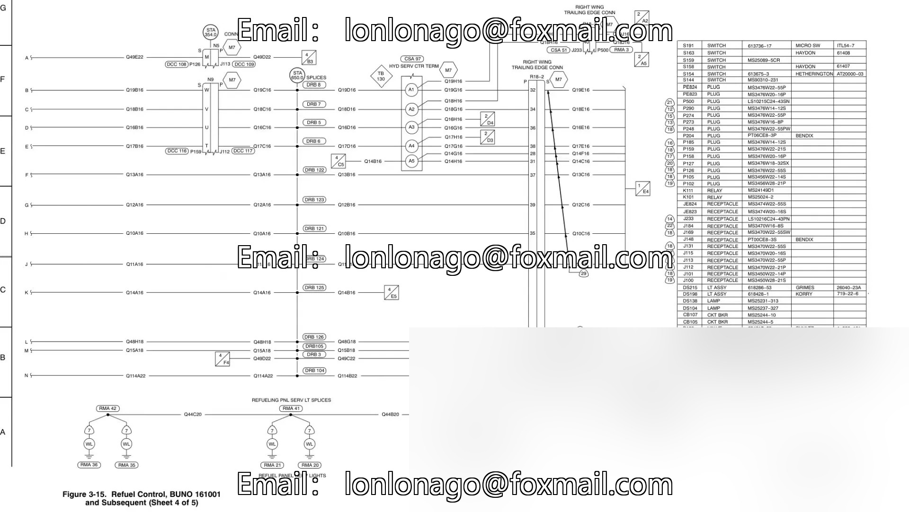

# The power system electrical wiring related to the US Navy P-3C "Hawk" anti-submarine patrol aircraft

## Body

Manual PDF for electrical system wiring data maintenance for the US Navy P-3C "Orion" anti-submarine patrol aircraft
340 pages
containing P-3C aircraft power device electrical system wiring data, suitable for maintenance, maintenance, and technical reference.
Need direct submission, contact privately for any issues.

This is a maintenance manual for electrical wiring data of the US Navy P-3C “Hawk” anti-submarine patrol plane's power drive, a PDF of 340 pages; it includes various electrical connections, switches and device identifiers.

<!-- AI_ENRICHED -->

## Images

## Payment

Here is a pay link on Stripe ( https://buy.stripe.com/3cs8yP7sY87d0vu9AB ). Please contact me lonlonago@foxmail.com after funding $89, and I will send you a complete data files , thank you!

